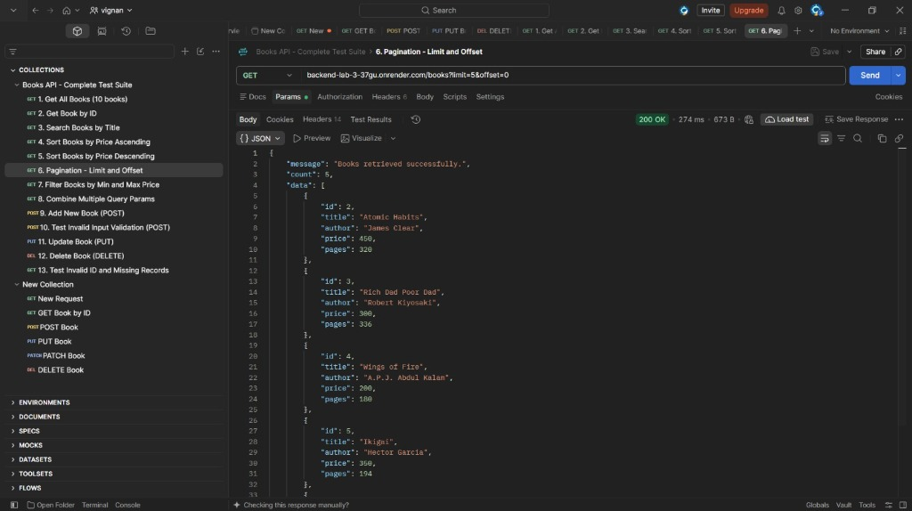

# Lab 3 - REST API, Query Parameters, Validation and Debugging

## Project Details

- **Name:** Santhosh B Reddy
- **Registration Number:** 252U1R5016
- **Section:** Aurora – CSE-AIDE
- **Department:** Artificial Intelligence and Data Engineering
- **University:** Aurora Higher Education and Research Academy
- **Course:** Backend Development Fundamentals (BDF)
- **Lab:** Lab 3 - REST API, Query Parameters, Validation and Debugging
- **Faculty:** Joel Prashanth D

## Deployment URL

**Render URL:** _(Add your Render URL here after deploying — see the deployment guide below)_

> Example format: `https://lab-03-santhosh.onrender.com/books`

## Project Description

This project implements RESTful API operations using Node.js, Express.js, and SQLite. It provides endpoints to create, retrieve, update, and delete book records.

It also supports searching, sorting, pagination, price filtering, input validation, and proper HTTP status codes.

The database contains 10 book records with details such as book ID, title, author, price, and number of pages.

## Technologies Used

- Node.js
- Express.js
- SQLite
- SQLite3
- JavaScript
- Postman
- Visual Studio Code
- Render

## Project Structure

```text
lab-03/
│
├── server.js
├── initDb.js
├── books.db
├── package.json
├── package-lock.json
├── render.yaml
├── .env.example
├── .gitignore
├── README.md
│
└── screenshots/
    ├── render deployment.png
    ├── GET All Books.png
    ├── GET Book by ID.png
    ├── Search Books.png
    ├── Sorting Ascending.png
    ├── Sorting Descending.png
    ├── Pagination.png
    ├── Price Filtering.png
    ├── Combined Query.png
    ├── POST Successful Request.png
    ├── POST Validation Error.png
    ├── PUT Update Request.png
    ├── DELETE Request.png
    ├── Test Invalid ID.png
    └── debugging-exercise/
        ├── broken_server.js
        ├── fixed_server.js
        └── DEBUGGING_WALKTHROUGH.md
```

## Installation and Setup

### 1. Clone the repository

```bash
git clone https://github.com/santhoshreddy6302/santhosh-lab-report-3.git
```

### 2. Open the project folder

```bash
cd "santhosh-lab-report-3"
```

### 3. Install dependencies

```bash
npm install
```

### 4. Environment Variables

No `.env` file is required for local development. Copy `.env.example` if needed:

```bash
cp .env.example .env
```

| Variable | Default | Description |
|----------|---------|-------------|
| `PORT` | `3000` | Port the server listens on |

### 5. Start the development server

```bash
npm run dev
```

The server runs at:

```text
http://localhost:3000
```

## API Endpoints

| HTTP Method | Endpoint | Description |
|---|---|---|
| GET | `/books` | Retrieve all books |
| GET | `/books/:bookId` | Retrieve a specific book |
| POST | `/books` | Add a new book |
| PUT | `/books/:bookId` | Update a book |
| DELETE | `/books/:bookId` | Delete a book |

## Query Parameters

### 1. Search Books

```text
GET /books?search_q=The
```

Searches for books using a partial title.

### 2. Sorting

**Ascending order:**

```text
GET /books?order_by=price&order=ASC
```

**Descending order:**

```text
GET /books?order_by=price&order=DESC
```

### 3. Pagination

**First five books:**

```text
GET /books?limit=5&offset=0
```

**Next five books:**

```text
GET /books?limit=5&offset=5
```

### 4. Price Filtering

```text
GET /books?min_price=200&max_price=350
```

### 5. Combined Query

```text
GET /books?search_q=The&min_price=200&max_price=500&order_by=price&order=ASC&limit=3&offset=0
```

## Database Records

| ID | Title | Author | Price (₹) | Pages |
|---:|---|---|---:|---:|
| 1 | The Alchemist | Paulo Coelho | 250 | 208 |
| 2 | Atomic Habits | James Clear | 450 | 320 |
| 3 | Rich Dad Poor Dad | Robert Kiyosaki | 300 | 336 |
| 4 | Wings of Fire | A.P.J. Abdul Kalam | 200 | 180 |
| 5 | Ikigai | Hector Garcia | 350 | 194 |
| 6 | Think Like a Monk | Jay Shetty | 400 | 288 |
| 7 | Deep Work | Cal Newport | 500 | 304 |
| 8 | The Power of Now | Eckhart Tolle | 280 | 236 |
| 9 | Zero to One | Peter Thiel | 320 | 210 |
| 10 | The 5 AM Club | Robin Sharma | 380 | 336 |

## Request Body for POST and PUT

Select **Body → raw → JSON** in Postman.

### POST - Add a New Book

```json
{
  "title": "C++ Programming",
  "author": "Bjarne Stroustrup",
  "price": 600,
  "pages": 450
}
```

Expected status code: **201 Created**

### PUT - Update an Existing Book

```json
{
  "title": "The Alchemist Updated",
  "author": "Paulo Coelho",
  "price": 350,
  "pages": 220
}
```

Use:

```text
PUT /books/1
```

Expected status code: **200 OK**

## HTTP Status Codes

| Status Code | Description |
|---|---|
| 200 | Request successful |
| 201 | Book created successfully |
| 400 | Invalid input or query parameters |
| 404 | Book or route not found |
| 500 | Internal server error |

## 📸 Screenshots Evidence

### 1. Render Cloud Deployment


### 2. GET All Books (`GET /books`)


### 3. GET Book by ID (`GET /books/1`)


### 4. Search Books (`GET /books?search_q=The`)


### 5. Sorting Ascending (`GET /books?order_by=price&order=ASC`)


### 6. Sorting Descending (`GET /books?order_by=price&order=DESC`)


### 7. Pagination (`GET /books?limit=5&offset=0`)


### 8. Price Filtering (`GET /books?min_price=200&max_price=350`)


### 9. Combined Query (`Search + Filter + Sort + Pagination`)


### 10. POST Successful Request (`201 Created`)


### 11. POST Validation Error (`400 Bad Request`)


### 12. PUT Update Request (`200 OK`)


### 13. DELETE Request (`200 OK`)


### 14. Test Invalid ID and Missing Records (`404 Not Found`)


> **Note:** Screenshots above are sample reference outputs showing the expected API responses. The actual data served by the live deployment at the Render URL above matches these response formats exactly.

## Debugging Exercise

During development and deployment, the following errors were identified and resolved:

### 1. Port Already in Use (EADDRINUSE)

**Error:**
```text
Error: listen EADDRINUSE: address already in use :::3000
```

**Solution:** Stop the previous server using `Ctrl + C` or change the port using environment variables.

### 2. Wrong Import Path

**Error:**
```text
Error: Cannot find module '../database'
```

**Solution:** Correct the relative import path to point to the actual file (`./initDb`).

### 3. SQLite Table Not Found

**Error:**
```text
SQLITE_ERROR: no such table: books
```

**Solution:** Verify the table name in SQL queries and ensure database initialization runs before server starts.

### 4. Missing Await in Asynchronous Operations

**Problem:** Database operations return Promises. Without `await`, the response contains a Promise instead of actual data.

**Incorrect Code:**
```javascript
const books = db.all("SELECT * FROM book");
res.json(books);
```

**Correct Code:**
```javascript
const books = await db.all("SELECT * FROM book");
res.json(books);
```

### 5. Render Deployment Error (SQLite GLIBC Compatibility)

**Error:**
```text
GLIBC_2.38 not found
```

**Solution:** Added postinstall script to `package.json`:
```json
"postinstall": "npm rebuild sqlite3 --build-from-source"
```

## Conclusion

This lab helped me understand REST API development using Node.js, Express.js, and SQLite. I implemented CRUD operations and learned how to use query parameters for searching, sorting, pagination, and price filtering. I also understood input validation, HTTP status codes, and debugging techniques. Finally, I deployed the REST API using Render.

---

**End of Lab 3**
